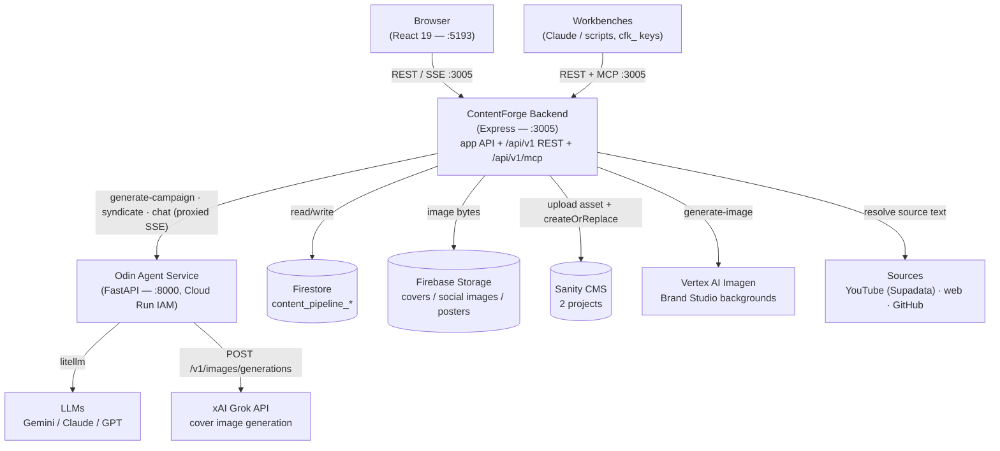
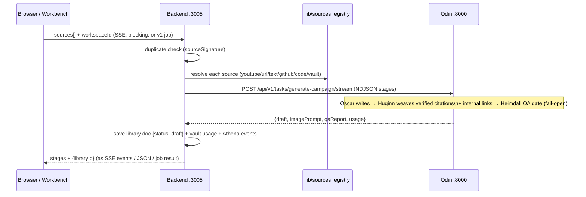

# Architecture

**Audience:** Engineers and technical contributors.  
**Purpose:** Understand how the three services fit together, what talks to what, and why.

---

## Services overview

ContentForge is composed of three independently-running processes and three external data stores.

| Service | Path | Port | Language |
| --- | --- | --- | --- |
| Frontend | `contentforge/frontend` | 5193 (dev; served from the backend's `dist/` in prod) | React 19 + Vite |
| Backend API | `contentforge/backend` | 3005 | Node.js + Express |
| Odin Agent | `odin-agent/` | 8000 | Python + FastAPI |

| Data store | Role |
| --- | --- |
| Firestore `content_pipeline_*` collections | Source of truth: `library` (items), `jobs` (v1 async jobs), `users`, `api_keys`, `invites`, `comments`, `notifications`, `vault`, `config` — see [`data-model.md`](data-model.md) |
| Firebase Storage `<project>.firebasestorage.app` | App-owned image bytes: article covers, social covers, approved poster renders |
| Sanity (two projects) | CMS target — written to only at publish time |

Two client populations talk to the backend: the **browser** (Firebase session) and **machine callers** — agentic workbenches and scripts with `cfk_` API keys, using the `/api/v1` REST surface or its MCP endpoint. Both resolve to the same `req.user` shape in `lib/authenticate.js`, so one authorization model covers everything.

---

## Component diagram



Note the browser never calls Odin directly: Odin requires authenticated invocation (Cloud Run IAM), so every chat/stream goes through the backend proxy (`/api/odin/chat/stream`, `/api/odin/studio/stream`), which authenticates the user, mints a Google-signed ID token for Odin, and pipes the stream back.

---

## The generation pipeline — one implementation, three entry points

The pipeline itself lives in `lib/generationPipeline.js` (validate → duplicate check → resolve sources → persona prompt → Odin campaign → save + side effects), with an injectable `onStage` callback. Three entry points adapt it:

| Entry point | Caller | Shape |
| --- | --- | --- |
| `POST /api/generate/content/stream` | The Forge UI | SSE — stages stream live |
| `POST /api/generate/content` | Legacy/blocking clients | One JSON response |
| `POST /api/v1/generations` → `lib/jobs.js` | Machines | 202 + job doc in `content_pipeline_jobs`, stages recorded on the doc, polled via `GET /api/v1/jobs/:id` |

The same pattern repeats across the API: Sanity publishing (`lib/publishArticle.js`), review submission (`lib/reviewSubmission.js`), comments (`lib/commentPosting.js`), and social generation (`lib/socialContent.js`) each live once in `lib/` and are shared by the app routes and the v1 surface.



---

## The external API surface (machines)

`lib/v1Operations.js` holds every v1 verb as a transport-free function. Two thin adapters serve it:

- **REST** (`routes/v1.js`) — `/api/v1/*`: workspaces, generations (job-style async), items (normalized across legacy data shapes), finalize, publish, reviewers, review submit, comments/mentions, socials. Errors are always `{ error: { code, message } }`. The contract is frozen in [`openapi.v1.json`](openapi.v1.json) and CI-checked (`tests/openapi.contract.test.mjs`).
- **MCP** (`routes/mcp.js`) — `/api/v1/mcp`: Streamable HTTP, stateless JSON mode; a fresh per-request server bound to `req.user` exposes each verb as a typed tool. No session affinity needed across instances.

Safeguards that hold on both surfaces because they live in auth/guards, not routes: API keys are workspace-scoped with no default access, can never mint or modify credentials, and can never delete content (`requireHumanSession` on the delete routes — there is no MCP delete tool at all). Review *decisions* stay human, in the app.

---

## Data flow: cover image (approve → save → publish)

```mermaid
sequenceDiagram
    participant UI as Browser (ImageChatModal)
    participant BE as Backend :3005
    participant OD as Odin :8000
    participant Grok as xAI Grok
    participant GCS as Firebase Storage
    participant Sanity as Sanity CMS

    UI->>BE: POST /api/odin/chat/stream (SSE proxy)
    BE->>OD: forward + Google-signed ID token
    OD->>Grok: generate image (via Hermes)
    OD-->>UI: SSE: {type: image, url} (piped through BE)
    UI->>BE: PUT /api/library/:id/cover {imageUrl | imageData}
    Note over BE: Grok URLs are temporary → bytes downloaded NOW\n(SSRF-guarded); Brand Studio covers arrive as data URLs
    BE->>GCS: save bytes (content-pipeline/covers/<id>)
    BE-->>UI: {coverImage: {url: relative proxy URL}}
    Note over UI,Sanity: — publish later —
    UI->>BE: POST /api/publish {libraryId}
    BE->>GCS: download bytes
    BE->>Sanity: assets.upload + createOrReplace
    BE->>BE: update {status: published, sanityId}
```

---

## Brand Studio

`frontend/src/brand-studio/` (`/brand-studio`, lazy-loaded, full-bleed) renders on-brand graphics **client-side**: templates are pure functions of `{ design, brand }` over the central brand registry (`brands.js`), exported as PNG/SVG/WebM in the browser. The backend's only roles are AI background generation (`POST /api/brand-studio/generate-image` → Vertex AI Imagen, per-brand style prompts) and receiving finished artwork (blog covers via the cover route; approved social posters frozen as PNG bytes in Storage).

---

## Key design decisions

### One auth model, two credential types
Firebase ID tokens (people) and `cfk_` API keys (machines) both resolve in `lib/authenticate.js` to the same `req.user` shape — role, workspace scope, reviewer grants — so every guard downstream applies unchanged. Machine-specific restrictions (`requireHumanSession`) are the exception, applied to credential management and content deletion.

### Shared libs, thin surfaces
Anything two surfaces need lives once in `lib/` (pipeline, publish, reviews, comments, socials, v1 operations). Routes and MCP tools are adapters. This is what makes the v1 compatibility promise (TECH_DEBT #1b) keepable.

### Cover images: app-owned until publish
Generated Grok image URLs are **temporary**. The backend downloads the bytes immediately at approval and stores them in Firebase Storage; Sanity upload happens only at publish time. Sanity is written *only* at publish — drafts never leave the app.

### Odin as gateway to LLMs — behind the backend
The Express backend never calls LLMs directly; all AI work goes through Odin. Odin itself is IAM-locked (backend-only): browsers reach it exclusively through the backend's SSE proxies, which forward the user's identity for usage attribution.

### Async where humans wait, jobs where machines poll
The browser gets SSE (live stages, no WebSocket complexity). Machines get job-style async (202 + poll) because generation runs minutes — with the operational consequence that the backend deployment must keep CPU allocated between requests (see [`configuration.md`](configuration.md)).

### Workspaces as config, not code
A workspace is a JSON object in `data/workspaces.json` (via the workspaces store) carrying persona, model, destination, social personas, and review policy. Adding a channel is a UI action, not a code change.
